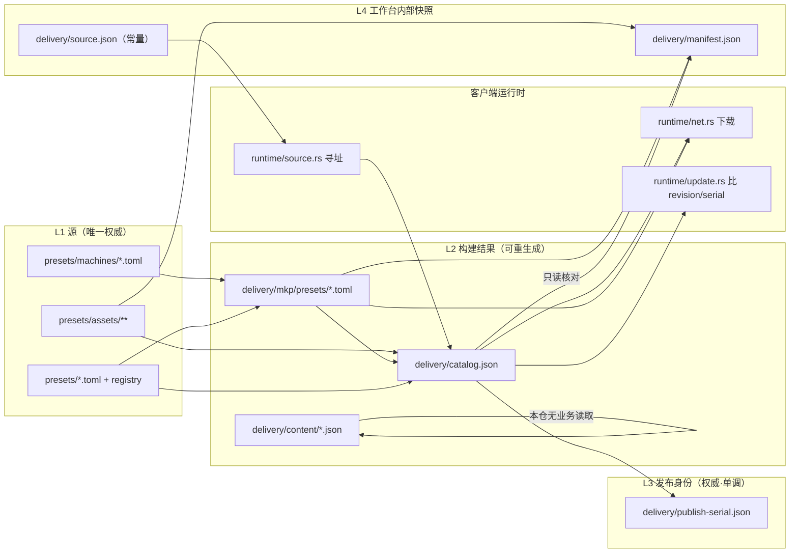

# 交付架构调研与目标设计（SupportEase Delivery）

> 日期：2026-11-07 ｜ 性质：**调研 + 设计**，不含代码改动
> 范围：`presets/` 源 → 生成 → 交付面 → 发布 → 客户端消费
> 状态：待裁决。裁决后由 `docs/DELIVERY-PIPELINE-REFACTOR.md`（尚未创建）之类的实施文档承接，本文不承担施工单角色。
> 引用约定：行号以 2026-11-07 工作树为准；外部结论一律给来源，"未核实"表示没拿到一手证据、不得据此施工。

---

## 0. 怎么读这份文档

- 只想看结论 → §1。
- 要判断"能不能删某份文件" → §3（生命周期表）＋ §4（重复事实源）。
- 要判断"改成什么样" → §6（目标架构）＋ §7（三个必答问题）。
- 要判断"先做什么" → §9（淘汰清单）＋ §10（迁移顺序）＋ §11（Delivery Lab）。

本文回答的不是"怎么修 P2S"，而是"为什么会出现需要用户理解的内部状态"。P2S 只作为证据出现。

---

## 1. 结论摘要

### 1.1 三个必答问题（一句话答案，展开见 §7）

| 问题 | 一句话答案 |
|---|---|
| 生成一次文件，为什么会让系统出现需要人工处理的"发布凭据失效"？ | 因为把 `manifest.json` 当成了**必须与盘上逐字节一致的持久凭据**，而它只能由发布事务写。生成与发布之间必然存在"产物新、凭据旧"，系统把这个正常中间态命名成"失效"。 |
| 停用一台机器，为什么会在其他地方产生孤立产物？ | 因为 `enabled` **只在 catalog 构建这一处被解释**（`runtime/catalog.rs:606`），而"哪些版本该生成 / 该在交付目录里"另有 4 处判据都不看 `enabled`。产物一旦落盘就进了"应该存在"的集合。 |
| 发布为什么要维护多套互相核对的状态？ | 因为"这一代发了什么"被同时写进 `catalog.json`（25 条）、`manifest.json`（17 条）和 `publish-serial.json`（serial + revision + catalogHash）三处，覆盖面不同、生命周期不同，核对器只能在它们之间做等式。 |

### 1.2 `manifest.json` 的定位判定：**B —— 仅工作台使用**

证据（详见 §4.1）：

- 客户端运行时的资源引用只有 `ResourceRef::Catalog` / `Release` / `ReleasePreview` / `Content` / `Entry`；`ResourceRef::Manifest` 的**唯一非测试使用点**是发布闸⑯的 URL 对账（`audit.rs:1182`），`runtime/**`、`ipc/**`、`src/**` 无任何业务读取。
- 客户端判断"有没有新东西"只比 `catalog.revision` / `catalog.publishSerial`（`runtime/update.rs:69-84`）；下载校验只用 `catalog.files[].sha256/size`（`runtime/delivery.rs:268-284`）。
- `manifest.json` 由 `PublishPlan::write`（`delivery.rs:1916`）在发布事务里写，`plan_publish`（`delivery.rs:1948`）纯算即可重生成；它当前的读者是工作台自己的三个地方：`manifest_drift`→`manifest_diagnosis`→`delivery_status`、`finalize_preview_with`/`manifest_preview`、发布闸⑭ 两账核对。

结论：它**不是**客户端契约（不是情况 C），也**不是**"正式发布元数据"（不是情况 A）。它是一份**内部发布快照**，却承担了"与盘上是否一致"的持久判定，这就是"凭据失效"的来源。

### 1.3 交付集合：5 个计算点，只有 1 处认 `enabled`

见 §4.2。`NoResources` 在 4 处一致过滤；`has_dimensions` 只有 2 处认；`enabled` 只有 catalog 一处认。

### 1.4 `source.json` 不必每代重写

正文由零输入常量 `bootstrap_json()` 生成（`delivery.rs:134-147`），任何代次字节相同。发布事务每代无条件写一次（`delivery.rs:1920`），git 不会出现 diff。它必须**至少存在**（客户端寻址必需、发布闸⑬是 Blocker），但"每代重写"只是无意义的写入动作。

### 1.5 现状规模（2026-11-07 实测）

```
catalog.json        25 条 = mkp_preset 8 · bbs_config 9 · model 5 · icon 3
                    publishSerial 8 · revision 9d6cd17786a456f0 · publishedAt 2026-11-05T14:31:21Z
manifest.json       17 条 = mkp_preset 9（含 P2S-standard）· slicerProfile 5 · icon 3
                    updated 2026-11-05
publish-serial.json serial 8 · revision dc0884e1b1b0c421 · catalogHash 0d3f47… · commitSha cbb80e0
```

`publish-serial.json` 的 `revision` 与 `catalog.json` 的 `revision` **不同**（`dc0884e1…` vs `9d6cd177…`），即 `publish_book::inspect` 判 `State::Stale` —— 与界面上"发布账本与当前目录不是同一代"是同一条事实。

---

## 2. 现状数据流

### 2.1 图（谁写、谁读、谁依赖）



### 2.2 四份文件的"谁"（证据）

| 文件 | 创建 | 读取（工作台后 / 客户端 / 其他） | 修改 |
|---|---|---|---|
| `manifest.json` | `PublishPlan::write`（`delivery.rs:1916`）；值在 `plan_publish` 组装（`delivery.rs:2082-2089`） | 工作台：`manifest_drift`→`manifest_diagnosis`→`delivery_status`（`delivery.rs:1486/1540/1195`）、`finalize_preview_with`（`build.rs:2055`）、`compare_ledgers` ⑭（`audit.rs:1243-1279`）、⑯ 仅纳入 URL 清单（`audit.rs:1182`）／客户端：**0 处** | 只有两个写入口：正式发布事务、`update_credentials_with`（`build.rs:2177-2181`）。人工被 `is_frozen`（`delivery.rs:700-706`）与生成事务（`delivery.rs:1749-1754`）挡住 |
| `catalog.json` | `PublishPlan::write`（`delivery.rs:1918`）、`write_catalog_json`（`delivery.rs:2241-2251`）、CLI `bin/gen-catalog.rs:98-105` | 工作台：`candidate_once`（`delivery.rs:849`）、`PublishIdentity::inherit_from`（`delivery.rs:2278`）、⑬⑭⑦（`audit.rs:1023/1257/729`）、`verify_delivery`（`app/mod.rs:222-252`）／客户端：**核心运行时**（`runtime/net.rs:563`、`ipc/catalog.rs:1209/1244`、`runtime/delivery.rs:242`、`runtime/update.rs:69-84`、`runtime/local.rs:357`、`runtime/source.rs:614/745`） | 生成重算（沿用身份与戳）、发布盖新身份 |
| `source.json` | `PublishPlan::write`（`delivery.rs:1920`），正文来自常量 `delivery.rs:134` | 工作台：⑬（`audit.rs:996-1046`）、⑯（`audit.rs:1093-1103`）／客户端：`runtime/source.rs` 寻址（`parse_source_json_with:764`、`resolve_entry:698`、`probe_custom_with:586`） | 发布事务每代写同内容 |
| `publish-serial.json` | `publish_book::save`（`publish_book.rs:210-216`），唯一调用 `delivery.rs:1922-1933` | 工作台：`inspect`（`publish_book.rs:233`）、`publish_tx::run/plan_only`（`:618/282`）、`audit::identity_plan`（`audit.rs:335-360`）／客户端：**0 处**（只用 catalog 里抄过去的 `publishSerial`） | 只有正式发布事务；序号唯一分配 `publish_tx.rs:701-709` |

---

## 3. 文件生命周期表

> "可重生成"= 从 L1 源 + 现有 L2 产物能否纯函数重算；"权威"= 能否被别的数据覆盖。

| 文件 | 层 | 创建者 | 消费者 | 客户端直读 | 入 Git | 上云端 | 可重生成 | 权威性 |
|---|---|---|---|---|---|---|---|---|
| `presets/machines/*.toml` | L1 | 人 / 工作台保存 | 全链路 | 随包内置（本地预设） | 是 | 否 | 否（源） | **唯一权威** |
| `presets/*.toml` + `registry/` | L1 | 人 / 工作台保存 | 全链路 | 随包内置 | 是 | 否 | 否（源） | **唯一权威** |
| `presets/assets/**` | L1 | 人（资产库） | 生成、发布 | 通过下载/随包 | 是 | 是（随目录） | 否（源） | **唯一权威** |
| `delivery/mkp/presets/*.toml` | L2 | 生成事务（`generate_transaction`） | 工作台、发布、客户端下载 | 是 | 是 | 是 | **是** | 可丢弃 |
| `delivery/content/*.json`（3 份） | L2 | 生成事务 | 仅工作台（⑯ URL 对账）；**客户端 0 处业务读取**（`ResourceRef::Content` 只在 `audit.rs:1203` + resolver 测试） | 否 | 是 | 是（当前确实上传） | **是** | 可丢弃（但**外部消费者未核实**，见 §4.5） |
| `delivery/catalog.json` | L2 + 索引 | 生成 / 发布 / gen-catalog | 工作台 + 客户端（发现、校验、下载地址） | **是（唯一必需）** | 是 | 是 | **是**（身份与戳须沿用或由发布给） | 索引权威（内容条目可重算，`publishSerial` 不可重算） |
| `delivery/source.json` | L4 | 发布事务 | 工作台⑬⑯ + 客户端寻址 | 是 | 是 | 是 | **是（常量）** | 常量 |
| `delivery/manifest.json` | L4 | 发布事务（+ 本轮新增的更新凭据） | 仅工作台（§1.2） | **否** | 是 | 是（source 声明了它） | **是** | 内部快照 |
| `delivery/publish-serial.json` | L3 | 发布事务 | 仅工作台 | 否 | 是 | 是（随目录一起推） | 否 | **序号权威**（单调，坏档报错不归零） |
| `delivery/release.json` / `release-preview.json` | L4（软件链） | 软件发版链 | 客户端更新检查 | 是 | 是 | 是 | 是 | 软件版本权威（另一条链） |

---

## 4. 重复事实源清单（逐条：证据 → 代价）

### 4.1 `manifest.json` 的定位与它的读者

- **证据**：见 §1.2 与 §2.2。`ResourceRef::Manifest` 定义在 `resolver.rs:257-264`，全仓非测试使用只有 `audit.rs:1182`。
- **代价（若降级为"内部报告"）**：
  - 发布闸⑭（`audit.rs:1243-1279`）与 `manifest_correct` 这套"两账一致"判据失去对象 → 要改成"catalog 自洽 + 产物字节一致"。
  - `source.json` 的 `manifest` 声明格（`bootstrap_json` 里的 `"manifest": MANIFEST_FILE`）与⑬的"声明物必在"要一起改，否则客户端侧虽然不读、闸会红。
  - 前端 `DeliveryFilesModal` 的"发布凭据已失效"区块、`FinalizeModal` 全部、`BuildPage` 的凭据读数要撤（见 §9）。
  - **收益**：删除"生成后凭据失效"这一整类状态与它带来的修复入口。

### 4.2 交付集合 5 个计算点，只有 1 处认 `enabled`

| 位置 | 函数 | 认 enabled | 认 NoResources | 认 has_dimensions | 枚举源 |
|---|---|---|---|---|---|
| `delivery.rs:642-671` | `delivery_expected_set` | 否 | 是 | 否 | `Book::versions()` |
| `delivery.rs:810-865` | `candidate_once` | 否 | 是 | 否 | `Book::versions()` |
| `build.rs:580-618` | `planned_todos` | 否 | 是 | **是** | `book.build_rows()` |
| `delivery.rs:1984-2013 / 2166-2196` | `plan_publish` 两个循环 | 否 | 是 | 否 | `Book::versions()` |
| `runtime/catalog.rs:566-572 → collect:582-656` | `build_from_presets_lenient` | **是**（`:606`） | 否（缺产物只记 missing） | 否 | `presetdata::Presets` |

- **代价（收敛）**：4 套枚举源要统一到一处（`DeliverableSet` 或等价函数），并区分"停用"与"暂无资源"两种不交付原因；`book.versions()` 与 `presets.catalog.machines()` 的差异（工作台是否显示停用机型）要一次定清。

### 4.3 `catalog` 与 `manifest` 重复登记、且覆盖面不同

- **证据**：`catalog.files` 25 条（mkp_preset 8 / bbs_config 9 / model 5 / icon 3）；`manifest.assets` 17 条（mkp_preset 9 / slicerProfile 5 / icon 3）。两者都用 `path`（或 `relativePath`）+ `sha256` + `size` 表达"发出去的是什么"，但：
  - catalog 有 `model` 5 条，manifest 没有；
  - manifest 有 `slicerProfile` 5 条，catalog 侧叫 `bbs_config` 9 条；
  - manifest 的 mkp_preset 是 9 条（含 P2S），catalog 是 8 条。
- **后果**：⑭"两账一致"永远在比较两个不同集合，必然产生"manifest 有、catalog 里没有"这类噪音（当前 3 条）。
- **代价（合并）**：删掉 manifest 后，"这轮发了什么"由 catalog 一代 + 发布回执（commit sha / 时间）承担；若仍要留一份发布清单，应为 `catalog.revision` 的子集导出，不再独立维护。

### 4.4 发布身份双存储：`catalog` 与 `publish-serial.json`

- **证据**：`catalog.catalogId` / `catalog.publishSerial` 与 `book.catalogId` / `book.serial`；`catalog.revision` 与 `book.revision` + `book.catalogHash`。实测二者已不同代（§1.5）。
- **判据**：`publish_book::inspect`（`publish_book.rs:233`）→ `State::{NoBook,InSync,Stale}`；`audit::identity_plan`（`audit.rs:332`）把 `Stale` 报成"不是同一代"。
- **代价**：
  - 保留双存储 → 必须接受"盘上 catalog 与账本偶发不同代"是**正常状态**（例如生成重算了 catalog 但未发布），界面不得报成故障。
  - 合并 → 序号只存一处（账本），catalog 的 `publishSerial` 由发布事务写入、只作客户端比较用；或反之（catalog 为唯一，账本只作本地备份）。两种都要改 `next_after` 与恢复路径（`publish_tx` 幂等恢复那段）。

### 4.5 `content/*.json` 三份：客户端无业务读取

- **证据**：`ResourceRef::Content(&str)` 只在 `audit.rs:1203`（⑯ URL 对账）与 `resolver.rs` 测试中出现；`runtime/**`、`ipc/**`、`src/**` 无业务读取（客户端展示机型走 `ipc/presets.rs:341 get_machines` → `load_presets(&app)` 读本地预设，不是远端 content）。
- **注意**：本仓内无消费者 ≠ 产品上不需要。**外部消费者未核实**，改动前需作者确认（是否有旧版客户端或第三方在用）。
- **代价（降级为不公开）**：`delivery_expected_set`/`candidate_once` 里三份 content 仍在，只是不进 `source.json` 的 `content` 声明或不上传；⑯ 的 content 对账要一并调整。

### 4.6 `source.json` 每代重写但字节恒定

- **证据**：`bootstrap_json()`（`delivery.rs:134-147`）零输入；`PublishPlan::write`（`delivery.rs:1920`）无条件写。
- **代价**：不写也不会坏（⑬ 只要求存在），但"发布事务写哪些文件"的清单会少一项；`release.json` 的同目录语义不受影响。

### 4.7 `manifest.updated` 参与观感但不表达内容

- **证据**：`plan_publish` 用 `meta.stamp` 写 `updated`（`delivery.rs:2082-2089`，`stamp` 来自 `now_iso8601`）。
- **后果**：任何"manifest 是否过期"的比较都必须剥掉这一行（`manifest_drift` 只比 assets，不看 `updated`；但人看文件时会以为变了）。
- **代价**：删 manifest 即消失；保留则文档与界面都不得拿它当"是否同一代"的判据。

---

## 5. 开源对照与取舍

> 只取"职责边界"，不取实现细节。每条给来源；读不到正文的地方标**未核实**。

### 5.1 Helm —— 包与索引分离

- 仓库 = `index.yaml` + 可选 `.tgz`；索引条目含 `urls` 与 `digest`（SHA256）。原文："A chart repository consists of packaged charts and a special file called `index.yaml` which contains an index of all of the charts in the repository."
- `helm repo index` **只生成索引、不做上传**；原文："The `helm repo index` command will generate an index file based on a given local directory that contains packaged charts." 上传是独立一步："you can upload the chart and the index file to your chart repository using a sync tool or manually."
- 包与索引可以不同服务器："It is not required that a chart package be located on the same server as the `index.yaml` file."
- 来源：<https://helm.sh/docs/topics/chart_repository/>
- **映射**：`catalog.json` ≈ `index.yaml`（条目 + digest + 下载 URL）；产物 TOML/资产 ≈ `.tgz`；发布 ≈ 生成索引 + 交给存储。**SupportEase 的问题不是"索引难"，而是把索引之外又维护了一份"发布清单"（manifest）并让它参与日常判定。**

### 5.2 GoReleaser —— 构建清单与发布元数据分离

- `checksums.txt`：默认生成**并随 release 上传**（"GoReleaser generates a …checksums.txt file and uploads it with the release, so your users can validate if the downloaded files are correct."），可 `disable: true` 关闭生成与上传。
- `artifacts.json`：默认生成在 `dist/`，"useful for integrating with other tools, such as `jq`"；**该页没有说明它是否随 release 上传 → 未核实**。
- 来源：<https://goreleaser.com/customization/package/checksum/>、<https://goreleaser.com/customization/general/artifacts/>
- **映射**：`catalog.files[].sha256/size` ≈ `checksums.txt`（客户端校验，必须公开）；`manifest.json` ≈ `artifacts.json`（内部清单，**不需要公开**）。这条正好支持 §1.2 的判定 B。

### 5.3 OCI Image Spec —— 内容身份与发布名称分离

- manifest 只存 descriptor（`mediaType` + `digest` + `size`），内容本体不入 manifest："This REQUIRED property references a configuration object for a container, **by digest**."
- `annotations` 是"内容之外"的任意元数据；`subject` 是弱引用。
- digest = 内容身份（"content-addressable images … hashed to generate a unique ID"）；**tag 的语义不在该页**（属 distribution spec）→ **未核实**（本轮未抓 distribution spec）。
- 来源：<https://raw.githubusercontent.com/opencontainers/image-spec/main/manifest.md>
- **映射**：`catalog.revision`（内容指纹）已经承担"内容身份"；`publishSerial` 更像"发布序号"而非 tag。不建议照搬 OCI 的多层 descriptor 模型（复杂度远超需求）。

### 5.4 Tauri Updater —— 描述与安装包分离

- `latest.json` 必填 `version`、`platforms.[target].url`、`platforms.[target].signature`；`signature` 必须是 `.sig` 文件的**内容**，"A path or URL does not work!"。
- 客户端先校验整个文件，再比版本；安装包由 `url` 单独下载；签名校验不可关闭。
- 来源：<https://v2.tauri.app/plugin/updater/>
- **映射**：`source.json` + `catalog.json` ≈ `latest.json`（发现 + 校验所需）；`release.json` 是软件版本链的同类物。**关键点：更新描述里的"校验信息"是随发布生成的一次性数据，不需要工作台再维护第二份"凭据"。**

### 5.5 四个方案对 SupportEase 的取舍

| 借鉴 | 采用 | 不采用（及原因） |
|---|---|---|
| Helm 包/索引分离 | 采用：`catalog` 是唯一公开索引，产物是可重生成的包 | 不采用"索引需人工 `repo index` 再上传"的双步骤：SupportEase 的发布事务可以一步完成，没必要暴露给人 |
| GoReleaser 构建清单 ≠ 发布元数据 | 采用：`artifacts.json` 类内部清单不公开 | 不采用"校验文件单独分发"：`catalog.files[]` 已内联 sha/size |
| OCI 内容 vs 名称 | 只采用"内容指纹与序号分开" | 不采用 descriptor/DAG/tag 那一整套 |
| Tauri 描述 vs 安装包 | 采用：描述文件里的校验信息由发布生成 | 不采用"外部静态 JSON"托管：SupportEase 用 Git 仓库当分发面 |

---

## 6. 目标架构（不预设 `DeliverableSet` / `DeliveryPlan` / `PublishIdentityPlan`）

### 6.1 四个层，各自只有一种职责

| 层 | 内容 | 谁写 | 能否重生成 | 是否公开给客户端 |
|---|---|---|---|---|
| **L1 源** | `presets/machines`、`presets/*.toml`、`registry`、`presets/assets` | 人 / 工作台保存 | 否 | 随包 / 下载 |
| **L2 构建结果** | 产物 TOML、`content/*`（如保留）、`catalog.json` 的**条目部分** | 生成（唯一写者） | 是 | 产物与 catalog 是 |
| **L3 发布身份** | `catalog.publishSerial` + 账本（二选一为权威，另一个降级为派生） | 发布事务（唯一分配处） | 否 | 仅 `catalog` 里的序号 |
| **L4 发现入口** | `source.json`（寻址）、`release.json` / `release-preview.json`（软件链） | 发布事务 / 软件发版链 | 是（常量） | 是 |

**`manifest.json` 在目标架构里没有位置**：它的两个用途分别被 L2（"这代有什么"= catalog 条目）与 L3（"发到几号"= serial + 回执 commit sha）覆盖。

### 6.2 三条硬边界

1. **派生文件不得成为下一次生成的输入。** 生成只读 L1；`catalog` 只读 L1 + L2 真字节；发布只读 L2 + L3。
2. **一代只有一个索引。** 不再维护"第二份要发什么"的清单；需要"这次发了什么"时，由发布事务当场算出并写进回执（`publish-history` / `release.json` 已有类似物）。
3. **序号只有一处分配。** 分配点唯一（`publish_tx`），其余模块只能读。

### 6.3 `enabled` 的解释权

- 只有一个函数解释它，产出三档：`deliverable` / `disabled`（人不让发）/ `excluded`（没有可发的东西，如无尺寸、无配方）。
- 三档**语义不同**，UI 必须分开显示："停用" ≠ "暂无资源" ≠ "待生成"。
- 停用机型的产物在生成事务里按"受管清单内不再产出"处理（列删除计划 → 回收站），不是"从来没生成过"。

### 6.4 生成后的状态词（替换"凭据失效"）

| 状态 | 判据 | 文案 |
|---|---|---|
| 源已变更 / 待生成 | L1 与 L2 字节不一致（`delivery_diffs` 有 Added/Modified/Removed） | 「有 N 份产物待生成」 |
| 有未发布的交付变化 | L2 已与 L1 一致，但与**上次发布**不同（`catalog.revision` ≠ 当前重算 revision） | 「有 N 份未发布的交付变化」 |
| 交付就绪 | 上述两者都没有 + 索引自洽 + 无残留 | 「交付就绪」 |
| 需要处理 | 集合不一致 / 索引漏登记 / 文件缺失 | 指向具体修复动作 |

禁止再出现：「凭据损坏」「定稿失败」「发布凭据失效」。

### 6.5 明确**不**新增的东西

- 不新增第四个"管理器"类型来串生成/检查/发布；如果某个中间结构只在一次调用链里活着，就不该成为长期状态。
- 不把发布身份塞进"交付计划"这类结构：身份是 L3，另有权威。
- 不为了"架构好看"保留 `manifest.json`：它的删除代价已在 §4.1 列清。

---

## 7. 三个必答问题的架构答案

### 7.1 生成一次为什么会出现"需要人工处理的发布凭据失效"

因果链（证据）：

1. `manifest.json` 只能在发布事务里写（`delivery.rs:1916`），但它的内容由 `plan_publish` 按**当前**产物算出（`delivery.rs:1948`）。
2. 生成事务改了产物字节 → 盘上 manifest 仍是上一代 → `manifest_drift`（`delivery.rs:1486`）逐条报 sha/size 不符。
3. 这个"落后"被命名成"发布凭据失效"，并被赋予一个**手工修复入口**（本轮之前的 `wb_update_publish_credentials`）。
4. 修复入口又必须证明"集合已收敛"，否则会把不该发的东西登记进 manifest —— 于是用户被迫理解 `catalog`/`enabled`/`planned_todos` 的关系。

**架构答案**：`manifest` 是发布快照，不是持久凭据。发布快照只在发布那一刻存在（可写进回执/发布历史），日常判定应基于"L2 是否等于 L1 重算结果"（可随时、无状态地重算）。删掉"持久凭据"这个概念，这一类故障与修复入口同时消失。

### 7.2 停用一台机器为什么会产生孤立产物

因果链（证据）：

1. `enabled` 只在 `runtime/catalog.rs:606` 被解释（catalog 不登记该机型）。
2. `delivery_expected_set`（`delivery.rs:642`）、`candidate_once`（`:810`）、`planned_todos`（`build.rs:580`）、`plan_publish`（`:1984`/`:2166`）都不看 `enabled`，只按 `Book::versions()` + `NoResources` 枚举。
3. 停用后，产物仍在 expected 集合里 → 生成不会清、发布核对要求它在 catalog 里 → 永远对不上（`delivery.rs:2179-2187` 报"产物发出来了，但说明书里没有登记"）。

**架构答案**：`enabled` 必须在**唯一的交付集合函数**里解释一次，其余模块消费结果；停用机型的产物要进入"应删除"（回收站），而不是"应存在"。工作台仍可显示/编辑它（`存在 ≠ 交付`）。

### 7.3 发布为什么要维护多套互相核对的状态

因果链（证据）：同一代事实被三处记录，覆盖面不同（§1.5、§4.3、§4.4）：

- `catalog.json`：25 条 + revision + serial + publishedAt；
- `manifest.json`：17 条 + updated（不同集合、不同戳）；
- `publish-serial.json`：serial + revision + catalogHash + commitSha。

任一处落后都表现为"故障"，而修复它们需要同时改多个事务 —— 这是"多套状态"的成本，不是业务复杂度。

**架构答案**：一代 = 一个索引（catalog）+ 一个序号（唯一分配点）+ 一条回执（谁在什么时候发的，可写在发布历史里，不参与判定）。核对从"三账相等"降为"索引自洽 + 产物字节一致 + 序号单调"。

---

## 8. 失败语义与机器生命周期

### 8.1 失败与回滚

| 场景 | 期望行为 | 现状能力 |
|---|---|---|
| 生成中途失败 | 整批回滚，盘上恢复原样 | 已有：`generate_transaction`（备份 → 写/移回收站 → 失败回滚 → 回读验证，`delivery.rs:1730`） |
| 发布中途失败 | 旧正式版本仍然有效；不得留下半代 | 已有：`publish_tx::run` 阶段快照 + `finalize_consistency`；但 manifest/catalog/账本三者非同笔事务，靠 git 同笔提交与幂等恢复补偿 |
| 重复发布相同内容 | 不推进序号（`NoChange`） | 已有：`publish_tx` 的 `nothing_to_publish` / `InSync` 判定 |
| 两次发布并发 | 不允许序号冲突 | 部分：序号分配在单会话锁内；跨进程并发**未核实** |
| 下载中途断开 / 文件被篡改 | 校验失败、不落盘为可用 | 已有：`runtime/delivery.rs:268-284` sha/size 校验 |

### 8.2 机器生命周期

| 动作 | 期望 |
|---|---|
| 新建 | 进 L1；`enabled` 默认 true；下次生成进入交付集合 |
| 停用 | 仍在 L1（可编辑）；退出交付集合；产物列删除计划 → 回收站；catalog 不登记 |
| 删除 | 源文件删除；产物与索引条目清理；回收站保留可恢复副本 |
| 恢复（重新启用/撤销删除） | 重新进入交付集合；重新生成；索引条目回来 |
| 切分支 | 不得继承错误发布身份：序号与 catalogId 只认同一条线（`catalogId` 判定口径见 `AGENTS.md` §6）；账本读不到时的行为必须明确（报错，不归零） |

---

## 9. 旧实现淘汰清单（逐函数）

> "阶段"对应 §10 的迁移顺序。"删除代价"= 会不会有客户端/外部消费者或闸门依赖。

### 9.1 交付集合与生成

| 符号 / 位置 | 现状职责 | 处置 | 阶段 | 替代者 / 删除代价 |
|---|---|---|---|---|
| `delivery::delivery_expected_set`（`delivery.rs:642`） | 交付目录"应该有"的集合 | 收编 | 2 | 唯一交付集合函数；删前须把 `scan_strays` 的两个调用（`audit.rs:850`、`delivery.rs:2364`）切过去 |
| `delivery::candidate_once`（`:810`） | 生成事务"该写什么" | 保留但改为消费唯一集合 | 2 | 无外部影响 |
| `build::planned_todos`（`build.rs:580`） | 生成队列 | 并入唯一集合 + 三档语义 | 2 | 见 §6.3 |
| `plan_publish` 两个 `versions()` 循环（`delivery.rs:1984/2166`） | manifest 组装 + 产物核对 | 与唯一集合共用枚举 | 2/4 | 删 manifest 后第一循环消失 |
| `Catalog::collect` 的 `enabled` 分支（`runtime/catalog.rs:606`） | 停用机型不进目录 | 改为消费唯一集合的结果 | 1/4 | 客户端随包目录同源变化（`build_from_repo`） |

### 9.2 发布凭据（manifest）家族 —— 整体删除

| 符号 / 位置 | 现状职责 | 处置 | 阶段 |
|---|---|---|---|
| `delivery::PublishPlan.manifest` + `write` 里写 manifest（`delivery.rs:1844/1916`） | 发布时写清单 | 删除 | 4 |
| `delivery::manifest_drift` / `ManifestDrift` / `ManifestDriftKind`（`:1486`） | 逐条比对"凭据 vs 盘上" | 删除 | 4 |
| `delivery::manifest_diagnosis`（`:1540`） | 人话版（`DeliveryStatus.manifestStale/Reasons`） | 删除 | 4 |
| `DeliveryStatus.manifest_stale` / `manifest_modified` / `manifest_reasons` | 前端读数 | 删除 | 5 |
| `audit::manifest_correct`（⑭，`audit.rs:1253`）/ `manifest_correct_strict` / `compare_ledgers`（`:1243`） | 两账一致 | 删除，改为"索引自洽" | 3/4 |
| `audit::finalize_checks`（`:373`） | ⑬⑭ 两格复用 | 删除 | 4 |
| `build::wb_finalize_preview` / `finalize_preview_with`（`build.rs:2026/2035`） | 交付检查器 | 删除（其"检查"语义并入统一检查器） | 3 |
| `build::wb_update_publish_credentials` / `update_credentials_with`（`:2039/2129`） | 手工更新凭据 | **删除**（产品裁决：不再有这一操作） | 4 |
| `build::manifest_preview` / `read_manifest` / `entry_diff`（`:2274/2196/2231`） | 定稿预览 | 删除 | 4 |
| `build::build_issues` / `FinalizeIssue` 家族（`:2337/1942-1970`） | 问题分类（fixable/source/identity/info） | 保留**语义**、换判据 | 3 |
| `build::credential_blockers`（`:2489`） | 写凭据前的保护 | 删除 | 4 |
| `audit::identity_plan` + `IdentityPlan`（`audit.rs:332`） | 下一号 / 是否同代 | 保留"下一号"；删除 `ledger_out_of_step` 的"同代"语义 | 4 |
| 前端 `views/FinalizeModal.tsx` + `.module.css` | 交付定稿模态框 | 删除 | 5 |
| `BuildPage` 的 `finalizeOpen/loadFinalize/updateCredentials`、`.linkBtn/.linkWarn` | 入口 | 删除 | 5 |
| `api.ts` 的 `finalizePreview`/`updatePublishCredentials` 与 4 个类型 | 前后端契约 | 删除 | 5 |
| `dev/mockBackend.ts` 的 `finalizeDemo` 与两个桩 | 演示 | 删除 | 5 |

> 删除代价：⑬（`source.json` 的 `manifest` 声明格）与 `bootstrap_json` 要同步去掉 `manifest` 键；否则闸会要求一份不再写的文件。客户端侧无影响（§1.2）。

### 9.3 双份发布身份

| 符号 / 位置 | 处置 | 阶段 | 说明 |
|---|---|---|---|
| `catalog.publishSerial` 与 `book.serial` | 保留双写，但**只把 book 当分配权威**；判定改为 `catalog.publishSerial == book.serial`（同事务写入后必须成立） | 4 | 不再有"同代/不同代"三态 |
| `book.revision` / `book.catalogHash` | 保留为"上一代指纹"，只用于幂等恢复 | 4 | 不参与界面判定 |
| `publish_book::State::{NoBook,InSync,Stale}` | 收成两态（有/无账本），`Stale` 不再作为"故障"报出 | 4 | 影响 `audit.rs:292`、`publish_tx:282` |
| `audit::identity_plan.ledger_out_of_step` | 删除 | 4 | 本次之前刚加 |

### 9.4 其它

| 符号 / 位置 | 处置 | 阶段 |
|---|---|---|
| `content/*.json` 三份的"公开"属性 | 待作者确认外部消费者后再定（本仓内无客户端读取） | 4 |
| `source.json` 每代重写 | 改为"内容不同才写"（`up_to_date` 同款判据） | 4 |
| `delivery::CONTENT_FILES` / `machine_catalog_json` / `bundles_json` / `assets_index_json` | 若 content 降级为内部，则不再进 `delivery_expected_set` 与上传清单 | 4 |

---

## 10. 分阶段迁移（每阶段独立可验收、不留兼容层）

| 阶段 | 内容 | 验收判据 | 回滚 |
|---|---|---|---|
| **0（本轮）** | 调研 + 本文档 + Delivery Lab 设计 | 三个必答问题有架构答案；`manifest` 判定有证据链 | — |
| **1 Lab 骨架** | 新仓库四角色 + 真实 fixtures + 统一协议 | 四角色可启动、读到同一批数据；`cargo test` 有冒烟 | 删除仓库即可 |
| **2 Lab 闭环** | 生成/检查/发布/下载全链 | 八步闭环自动化测试全绿；无 Mock 发布 | 同上 |
| **3 Lab 生命周期** | 停用/删除/恢复/切分支/重复发布/失败回滚 | 12 条破坏性矩阵全绿 | 同上 |
| **4 SupportEase 收口** | 唯一交付集合 + 检查器统一 + 删 manifest 家族 + 身份收成两态 | `presets check/diff/verify` 全绿；P2S 停用后自动退出交付集合且有清理结果；生成后再无"凭据失效"文案 | 单分支回退；`presets/delivery/**` 由 `git restore` |
| **5 BuildPage 重做** | 三数字 + 三行摘要 + 文件变化 + 两个主操作 | 页面不再出现"凭据/定稿/检查编号"；所有问题可点开看原因与动作 | 旧页面保留到本阶段末再删 |
| **6 清旧实现** | 删除 §9 全部条目与死代码 | 全仓无 `manifest_*` / `finalize_*` / `credential_*` 残留；`cargo clippy` 干净 | 分文件回退 |

**不许出现的行为**（每阶段都验）：

- 用户需要手工修复由正常生成引起的 SHA / size 差异。
- 停用机器产生孤立产物、或产物清理需要人手工删。
- 正式发布失败却让客户端看到半成品。
- 前端自行判断"这条能不能修"（必须由后端给 `kind + allowedAction`）。
- 为兼容旧状态而新增"第二套判据"。

**风险**：

| 风险 | 应对 |
|---|---|
| 删 `manifest` 影响外部消费者 | §4.1 已确认客户端 0 处；发布前用一次真实客户端冒烟（LaB 的 Client Simulator 覆盖） |
| 共享层 `enabled` 改动影响随包目录 | 阶段 4 前先在 Lab 验证；SupportEase 侧用 `presets verify` + 现有 catalog 相关测试兜底 |
| `content/*.json` 有未知外部消费者 | 阶段 4 前向作者确认；未确认就保持上传但标"待观测" |
| 序号双存储合并引发恢复路径回归 | 保留 `publish_tx` 幂等恢复测试；新增"账本坏档"用例 |

---

## 11. Delivery Lab：独立参考实现与端到端验证

> 目标路径：`/Users/wzy/projects/SupportEase-Delivery-Lab`（空目录，本节只设计，**不建仓**）。
> 定位：SupportEase 新交付架构的**可运行参考实现**，不是 Demo、不是测试夹具。先在 Lab 证明闭环，再谈移植。

### 11.1 为什么必须先建 Lab

在 SupportEase 里直接改，旧的文件/事务/类型/调用关系会反向约束新架构，最后容易变成"新架构依赖旧 manifest、又兼容旧 catalog、还得调旧事务"。Lab 没有这些包袱：输入可以是真实 TOML，但生成、发布、下载都在独立目录与独立 Git 仓库里跑；**原仓库只读**。

### 11.2 技术选型（两案）

| | 案 A（推荐）Rust 核心 + 本地 Web UI + 本地 HTTP 远端 | 案 B TypeScript/Node 全栈 |
|---|---|---|
| 生成/解析 | 复制 `presetdata` 的 TOML 解析与 `mkp_file_name`、`runtime::catalog` 的条目/指纹算法（隔离后按需裁剪） | 用 JS TOML 解析重写，需逐条对齐 SupportEase 行为 |
| UI | 最小可操作页面（改参数/停用/生成/发布/客户端下载） | 最快 |
| 协议可信度 | **高**：与将来移植同语言、同算法 | 中：移植时二次对齐，易漂移 |
| 风险 | UI 成本略高；需防止把旧耦合一起复制 | 生成逻辑与真实实现漂移，Lab 结论不可直接迁移 |
| 结论 | **推荐** | 仅在"只想快速看一版 UI"时用 |

**复用清单（案 A）**

| 来源 | 复用方式 | 旧架构耦合 | 处理 |
|---|---|---|---|
| `presetdata` 的机型/版本/资产结构体与 TOML 读取 | 复制到 Lab 的 `core/`，保留字段语义 | 低（纯解析） | 去掉 `enabled` 之外的 UI 字段 |
| `presetdata::mkp_file_name` | 直接复制（含测试） | 无 | 保留"与生成器逐字一致"的测试 |
| `runtime::catalog` 的 `Catalog`/`CatalogFile`/`revision` 算法 | 复制结构 + 指纹算法 | 中（与 resolver 有耦合） | 只取 schema 与指纹，不带 resolver |
| 产物渲染（`render`） | **重写最小版**（按源字段直出 TOML） | 高（依赖 registry/参数层） | 不在 Lab 复刻全部参数语义，只用少量真实字段 |
| `runtime::resolver` 的寻址语义 | 作为**协议参考**，不复制代码 | 中 | Lab 用"source.json + 相对路径"等价模型 |

**必须重写**：交付集合、生成计划、索引生成、发布事务、客户端模拟器（下载 + 校验 + 落盘）、四角色协议。
**禁止带入**：`manifest.json` 及其 `manifest_drift`/`manifest_diagnosis`；`finalize_*` 家族；`compare_ledgers` 两账核对；`identity_plan` 的"同代"判定；`delivery_expected_set`（5 套之一）。

### 11.3 目录（初始建议，可被调研推翻）

```
SupportEase-Delivery-Lab/
├── fixtures/              # 从 SupportEase 复制的真实输入（只读副本，带来源说明）
│   ├── machines/ presets/ registry/ assets/
├── core/                  # 交付核心（纯函数，无 IO）
│   ├── deliverable_set/   # 唯一交付集合
│   ├── plan/              # 生成计划（新增/修改/删除/不变）
│   ├── index/             # 仓库索引（catalog 等价物）
│   └── hash/              # sha256 / size
├── pipeline/              # 执行器（唯一写者）
│   ├── generate/  validate/  cleanup/
├── publisher/             # 发布事务（分配序号、写索引、提交、推送）
├── workbench/             # 本地 Web UI（改源 / 停用 / 触发生成 / 触发发布）
├── client-simulator/      # 只经 HTTP 读远端（发现、下载、校验、落盘）
├── repository/            # 模拟远端（releases/<serial>/ + index/）
├── tests/                 # integration/ failure/ lifecycle/
├── docs/                  # ARCHITECTURE.md / PROTOCOL.md
└── README.md
```

若结论是 `manifest` 不需要公开，目录里**不保留**对应物；`repository/` 只放客户端真正要取的文件。

### 11.4 四角色与共享协议

| 角色 | 只做 | 绝不 |
|---|---|---|
| Workbench | 改 L1（参数/启用停用/增删版本）、看源与修改结果、点"生成"/"发布" | 不直接写 L2/L3 |
| Build | 消费唯一交付集合 → 出计划 → 执行（写/清）→ 算摘要 → 出检查报告 | 不分配序号、不读上次发布索引当输入 |
| Publisher | 确认内容 → 分配序号 → 写索引与 source → commit → push 模拟远端 | 不生成产物、不改 L1 |
| Client Simulator | 只经 HTTP 读 `source.json` → `index` → 下载 → 校验 sha/size → 落盘 → 切预设 | 不读 Lab 本地文件、不信任未校验内容 |

**共享协议**：L2/L4 文件格式（`source.json` 寻址、`index` 条目含 `path`+`sha256`+`size`+`serial`+`revision`）、目录布局、HTTP 路径规则。四角色共享同一份 fixtures 与同一份发布结果，不得各造数据。

### 11.5 八步端到端闭环（自动化集成测试）

1. 导入真实 fixtures（机器 TOML / 预设 TOML / registry / assets）。
2. Workbench 把 P2S 从 `enabled=false` 改为 `true`。
3. Build 生成：P2S 产物出现，交付集合随之变化。
4. 检查：产物、索引、摘要一致，**无孤立文件**。
5. Publisher 发布：分配新序号，写索引与 source，commit + push 模拟远端。
6. Client Simulator（全新状态）从远端发现该版本。
7. 下载 P2S 预设并校验 sha/size，内容与发布时逐字节一致。
8. Workbench 停用 P2S → 再生成、再发布 → 客户端发现它已不在可交付集合，旧文件不再被引用。

**硬要求**：发布与下载必须经过**持久化边界**（文件系统 + HTTP），不得在内存里互传对象；不允许 Mock 发布成功。

### 11.6 四轮计划

| 轮次 | 内容 | 验收 |
|---|---|---|
| 1 骨架 | 四角色可启动、fixtures 导入、协议文档、最小 UI | 四角色读到同一批数据；`cargo test` 有冒烟 |
| 2 闭环 | 八步链路 + 持久化边界 | 八步集成测试全绿 |
| 3 生命周期 | 停用/删除/恢复/切分支/重复发布/失败回滚 | §11.7 矩阵全绿 |
| 4 生产化 | 事务、并发、Git 远端适配、真实客户端协议对齐 | 可作为 SupportEase 迁移基线 |

### 11.7 破坏性测试矩阵（12 条）

| 人为操作 / 故障 | 期望 |
|---|---|
| 改源后不生成 | 明确显示"源与产物不同步" |
| 连续生成两次 | 第二次零变化，不产生垃圾改动 |
| 停用机器 | 退出交付集合并清理过期产物（回收站） |
| 删除机器 | 相关交付文件有明确清理结果 |
| 恢复机器 | 重新生成并正确回到交付集合 |
| 切换 Git 分支 | 不继承错误发布身份 |
| 手改生成后的产物 | 自动发现内容不一致 |
| 发布中断电/失败 | 旧正式版本仍有效 |
| 重复发布相同内容 | 不产生虚假的内容版本 |
| 下载中途断开 | 不把不完整文件当可用 |
| 下载文件被篡改 | 校验失败、不应用 |
| 两次发布并发 | 不允许序号冲突 |

### 11.8 Lab 验收原则（8 条）

1. 不依赖 SupportEase 的旧发布事务即可运行。
2. 不依赖旧 `manifest` 即可生成与发布（除非调研证明客户端协议需要它）。
3. 不出现两套交付集合算法。
4. 不出现需要人工修复的正常 SHA / size 差异。
5. 不出现停用机器留下的孤立产物。
6. 不出现发布失败却让客户端看到半成品。
7. 不出现"下载成功但未校验"。
8. 相同源输入 + 相同发布身份产生可预测结果。

### 11.9 移植回 SupportEase 的边界

- 只搬**协议**（索引 schema、寻址规则、发布语义）与**核心算法**（交付集合、生成计划、索引生成、校验）。
- 不搬 Lab 的 UI 与目录结构。
- 移植前必须先有：Lab 四轮全绿 + 本文档 §6 的架构裁决落定（尤其是 `manifest` 去留、双份身份合并方式、`content/*.json` 是否公开）。
- 移植时沿用原仓既有事务能力（`generate_transaction` 的备份/回滚/回读），不要另造第二套事务。

### 11.10 本轮不做的

- 不创建 Lab 任何文件（目录保持空）。
- 不改 SupportEase 任何业务代码、`presets/**`、发布元数据。
- 不因为本文档就开工迁移；迁移顺序与验收见 §10，需另行批准。

---

## 附：证据索引（本仓）

| 主题 | 位置 |
|---|---|
| 资源引用枚举 | `src-tauri/src/runtime/resolver.rs:246-300` |
| 客户端更新判定 | `src-tauri/src/runtime/update.rs:69-84` |
| 下载校验 | `src-tauri/src/runtime/delivery.rs:268-284` |
| 客户端寻址 | `src-tauri/src/runtime/source.rs:586/698/764` |
| `enabled` 唯一解释点 | `src-tauri/src/runtime/catalog.rs:606` |
| 交付集合 5 处 | `delivery.rs:642/810/1984/2166`、`build.rs:580`、`runtime/catalog.rs:566` |
| 生成事务 | `delivery.rs:1730` |
| 发布事务 | `src-tauri/src/workbench/app/publish_tx.rs`（`run` / `plan_only`） |
| 发布闸十七项 | `src-tauri/src/workbench/app/audit.rs:197` |
| 序号账本 | `src-tauri/src/workbench/app/publish_book.rs`（`inspect` / `State` / `next_after`） |
| 产物命名 | `src-tauri/src/presetdata/mod.rs:178` |
| 本轮新增的凭据家族 | `build.rs:2026/2039/2129/2274/2337/2489`、`audit.rs:332/373`、`views/FinalizeModal.tsx` |

## 附：外部来源

| 主题 | 来源 | 备注 |
|---|---|---|
| Helm 仓库/索引 | <https://helm.sh/docs/topics/chart_repository/> | 已核实原文引用 |
| GoReleaser checksums | <https://goreleaser.com/customization/package/checksum/> | 已核实：默认生成并随 release 上传 |
| GoReleaser artifacts.json | <https://goreleaser.com/customization/general/artifacts/> | **是否默认上传：未核实**（该页未说明） |
| OCI image manifest | <https://raw.githubusercontent.com/opencontainers/image-spec/main/manifest.md> | digest 引用已核实；**tag 语义未核实**（在 distribution spec） |
| Tauri Updater | <https://v2.tauri.app/plugin/updater/> | 已核实：`latest.json` 字段、签名内联、安装包分离 |

