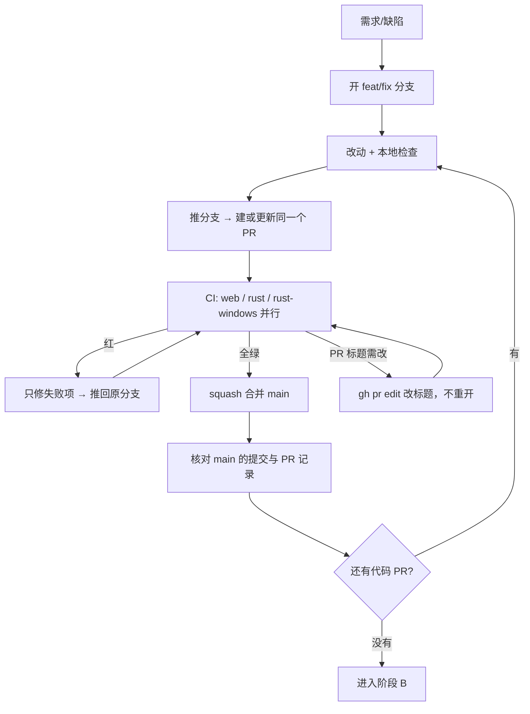
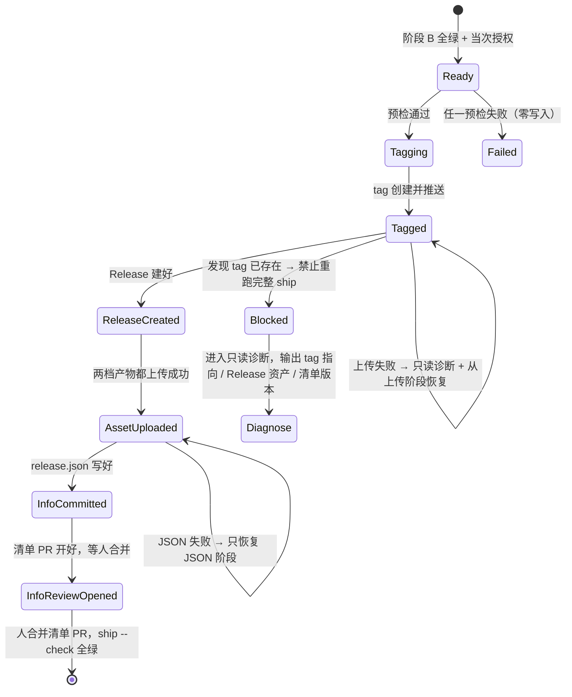

# 发布机械协议：PR 与正式发布

> 这是 PR 与软件版本发布的**执行规则**。AI 只负责写改动；流程合法性由脚本判定，
> 不靠 AI 记住“这次该干什么”。改本文要作者点头。
>
> 与 [`RELEASE-TRANSACTIONS.md`](RELEASE-TRANSACTIONS.md) 的分工：那份管“发布预设 ≠ 发布软件版本”
> 的概念；本文管“代码 PR 与软件版本发布按什么顺序、谁闸住、失败回到哪”。
>
> **实施状态（2026-11-21）**：PR 幂等、CI 统一入口、tag 排到构建之后、
> `InfoOnly` 只补清单恢复已经落地；十种故障场景中已有构建失败不留 tag、
> 只补清单、构造 PR 标题等机器判据，其余仍需真机演练。各节末的“现状差距”逐条更新。

---

## 0. 三条不可越过的时间线

```text
阶段 A  开发与 PR          ── 不改正式版本号、不写 release.json、不打 tag
阶段 B  最终发布准备        ── 可以改程序版本文件、可以构建；绝不打 tag
阶段 C  正式发布            ── tag 是最后动作之一；tag 之后不许改代码
```

两样东西必须分开：

| 东西 | 何时写 | 为什么 |
| --- | --- | --- |
| 程序版本文件（`version.toml` + 四处派生） | **阶段 B**，所有代码 PR 合并后 | 安装包里自报的版本来自编译期常量，必须在构建前改好 |
| `presets/delivery/release.json` | **阶段 C**，产物上传成功之后 | 它要写下载地址和 SHA，必须先有真实上传产物 |

提前写 `release.json` 不会让 tag 更早生效，只会让人误以为“清单准备好了就能发”。
tag 早于构建是这次事故的根源：构建失败时 tag 已经推到远端，重跑又被 tag 闸拦住。

---

## 1. 阶段 A：开发与 PR

### 入口条件

- 有一个待改的需求 / 缺陷。
- 当前分支不是 `main`；分支名带 `feat/ fix/ refactor/ chore/ docs/ style/` 前缀。

### 允许

1. 改源码、改测试、改文档。
2. 本地跑改动相关检查（与 CI 同一入口，见 §4）。
3. 推到**同一个分支**、更新**同一个 PR**。
4. CI 红了就在原分支修复再推；只重跑失败的那一项。
5. CI 全绿后合并进 `main`。

### 禁止

- 改 `version.toml` / `package.json` / `src-tauri/Cargo.toml` / `src-tauri/tauri.conf.json` / `Cargo.lock` 里的正式版本号。
- 改 `presets/delivery/release.json` 或 `release-preview.json`。
- 创建任何 `v*` tag。
- 仅因为最新提交标题变了就关闭重开 PR。

### PR 生命周期



### 硬约束

| 约束 | 脚本行为 |
| --- | --- |
| 一个任务一个分支一个 PR | 重复执行 `npm run pr` 只能找到并更新同一个 PR |
| PR 标题独立于提交标题 | 改标题走 `gh pr edit`，不允许关旧开新 |
| CI 全绿才允许合并 | 合并前重查 checks；红 / 排队未完成都不合 |
| 只重跑失败项 | 记录每项 check 的结论，绿的不重跑 |
| 合并后核验 | 核对 `origin/main` 的提交 sha 与 PR 的 squash 记录 |

### 落地证据

- `scripts/pr.mjs` 已改为按分支查 `--state all`：open 复用、merged 直接报“已合并”，
  标题取 `--title` / 最早提交 / 分支名，不再与最新提交绑定。
- `scripts/check-pr.mjs` 的标题判据同步改成“显式 > 最早提交 > 分支名”。
- `scripts/check/run.mjs` 是本地与 CI 共用入口；CI 三个 job 已改为调用它。

---

## 2. 阶段 B：最终发布准备

### 入口条件

- 所有代码 PR 已合并，`main` 干净且 `git fetch` 后与 `origin/main` 一致。
- 用户已明确给出要发的正式版本号（如 `0.0.12`）。

### 允许

1. 在发布准备分支上改程序版本文件到目标号，并用 `npm run version:check` 确认五处一致。
2. 构建安装版与绿色版。
3. 检查产物：自报版本、文件完整性、SHA、大小。
4. 失败则停止发布，回阶段 A 修代码，重新走 PR，再重新准备。

### 禁止

- 创建或推送 `v*` tag。
- 建 Release、上传产物。
- 写 `release.json`。
- 用“构建快成功了”当理由提前打 tag。

### 门禁

| 门禁 | 判据 |
| --- | --- |
| 主线干净 | `git status --porcelain` 为空；`origin/main` 已 fetch |
| 版本一致 | `version.toml` 与四处派生都等于目标正式号 |
| 安装版构建成功 | 产物存在、自报版本 == 目标号 |
| 绿色版构建成功 | 产物存在、自报版本 == 目标号 |
| 产物可核验 | 大小 > 0、SHA-256 已记录、与清单资产一一对应 |
| 无 tag | 本地与仓库都没有目标 tag |

### 落地证据

- `release_tx.rs` 已把 tag 创建移到构建、产物自报版本核对、构建期间 HEAD 未变这三关之后。
- 构建失败/版本不符时直接返回，不创建 tag、不建 Release。
- Windows 构建同时产出安装版与绿色版；两者都进 Release，失败则停在 tag 之前。

---

## 3. 阶段 C：正式发布

### 入口条件

- 阶段 B 全部门禁绿。
- 用户**当次**明确授权真发布，`--confirm` 已给。

### 固定顺序

1. 最终一致性预检：主线、版本、产物、SHA、目标仓库。
2. 创建并推送 tag `v<版本>`。
3. 创建 Release。
4. 上传安装版与绿色版。
5. 根据**已上传**的产物生成 `release.json`，写入版本号、下载地址、SHA。
6. 核对 GitHub tag / Gitee Release / 远端 tag / main 清单四者一致。

### 状态图



### 不可逆保护

| 约束 | 脚本行为 |
| --- | --- |
| tag 前必须完成构建与产物验证 | 阶段 B 门禁全绿才允许进入 `Tagging` |
| tag 后不改代码 | 内核在构建前再核 `tag` 与 `HEAD`（`frozen_elsewhere`） |
| tag 已存在 | 禁止重跑完整 `ship`；进入只读诊断与阶段恢复 |
| 不自动删 / 移 / 覆盖已推 tag | 任何修复都必须显式授权，且先写清后果 |
| GitHub / Gitee tag 不一致 | 拒绝继续发布并列出两边 sha |
| 产物提交与最终发布提交不一致 | 拒绝发布 |

### 恢复入口

只允许“从当前阶段往后接着做”，不允许从头重跑：

| 失败阶段 | 恢复动作 |
| --- | --- |
| 创建 Release 失败 | 从 Release 阶段重试，不碰 tag |
| 上传失败 | 从上传阶段重试，不碰 tag |
| `release.json` 校验 / 提交失败 | 只恢复清单阶段 |
| manifest 大 PR 未合并 | 人合并后跑 `npm run ship -- --check` |
| tag 已存在但 Release 无资产 | 只读诊断后进入 `Append` 补包；不得整趟重跑 |
| tag 指向与当前 HEAD 不同 | 停止；列出两边 sha，由人决定，不自动改写 |

### 落地证据

- `ReleaseSlot` 增加 `InfoOnly`：tag 与两档产物都在、只差清单时，只补清单，
  不重构建、不重传、不动 tag。
- `Append` 仍负责“本平台包缺”的补包；两者都要求 tag 指向当前 HEAD。
- `ship --check` 仍只核三格；产物与提交的身份由 `release_tx` 的构建基线核对兜住。

---

## 4. 本地检查与 CI 同一入口

目标：CI 的每个 job 都对应一条本地命令；本地跑过绿，CI 不应该因为同一条检查再红。

```text
scripts/check/
  lint          # npm run lint
  typecheck     # npx tsc -b
  rust          # cargo fmt --all -- --check + 两组 clippy + 两组 test
  rust-windows  # Windows 独立 crate 的 cargo check
  web           # build + check:bundle + check:zero-network + check:channel-args + check:release-source
  build         # 安装版 + 绿色版
  all           # 上述全部；CI 与发版前都调它
```

- CI 工作流只调用 `scripts/check/<name>`，不内联另一套命令。
- `npm run release` 前置检查只调用 `scripts/check/all`，不再自己拼一遍。
- 失败时按名字单独重跑：`node scripts/check/rust-windows.mjs`。
- CI 三个 job（`web` / `rust` / `rust-windows`）并行；`build` 是阶段 B 的本地动作。
  绿的那几项不重跑。

### 落地证据

- `scripts/check/run.mjs` 提供 `web` / `rust` / `rust-windows` / `build` / `all`；
  CI 三个 job 已改为调用 `npm run check:web|check:rust|check:rust-windows`。
- `package.json` 的 `check:rust` 已切到同一入口；`release.mjs` 的前置校验也改调
  `scripts/check/run.mjs web|rust`。

---

## 5. 发布前检查器（目标判据）

只回答机器能判的项；任一红就停，并指出文件名，不允许 AI 代替判断：

```text
[ ] 所有代码 PR 已合并
[ ] main 与 origin/main 一致且工作区干净
[ ] 正式版本文件 == 目标版本，四处派生一致
[ ] 安装版构建成功，自报版本 == 目标版本
[ ] 绿色版构建成功，自报版本 == 目标版本
[ ] 两份产物大小 > 0，SHA-256 已记录
[ ] release.json 目标内容正确（版本 / 资产名 / SHA / 地址）
[ ] tag 尚不存在；若存在则进入只读诊断
[ ] GitHub / Gitee 目标仓库正确、tag 未分叉
```

---

## 6. 十种故障场景（改造后必须逐条验收）

| # | 场景 | 期望 |
| --- | --- | --- |
| 1 | CI 第一次失败，修复后推原分支 | 复用同一 PR；只重跑失败 check |
| 2 | 最新提交标题变了 | 不改 PR 标题、不重开 PR |
| 3 | Windows check 失败 | 只重跑 `rust-windows`，其余不重跑 |
| 4 | 安装版构建失败 | 停在阶段 B；无 tag |
| 5 | 绿色版构建失败 | 停在阶段 B；无 tag |
| 6 | JSON 校验失败 | 停在阶段 C 的清单阶段；tag 已存在时只恢复清单 |
| 7 | tag 成功、上传失败 | 从上传阶段恢复；不重打 tag |
| 8 | 重复执行 ship | 不重复建 tag / Release，进入当前阶段 |
| 9 | GitHub / Gitee tag 不一致 | 拒绝继续，打印两边 sha |
| 10 | 产物提交 ≠ 最终发布提交 | 拒绝发布，打印两个 sha |

已有机器判据：

- #4 / #5：`release_tx::tests::a_failed_build_leaves_no_tag`（构建失败不留 tag / Release）。
- #6 / #7：`the_release_slot_is_decided_per_platform` 覆盖 `InfoOnly`（只补清单）与 `Taken`。
- #2：`check-pr.mjs` 覆盖“PR 标题独立于后续提交”。
- #3：`scripts/check/run.mjs rust-windows` 可单独重跑；CI 已按 job 并行。
- #1 / #8 / #9 / #10 仍需真机 gh/发布仓库演练，**尚未自动化**，不得声称已通过。

## 0.0.12 现场核查（2026-11-21）

- GitHub 与 Gitee 的 `v0.0.12` raw ref 都是 `e1de821`，这是 **annotated tag 对象**；
  两边剥开后都指向提交 `a4fcc43`，**没有分叉**。
- 之前的“tag 指向与 HEAD 不同”是脚本拿 tag 对象 SHA 比提交 SHA 的误报，
  已在 `check-release-readiness.mjs` 修正为优先读 `^{}` 剥皮行。
- GitHub / Gitee Release 均未创建，安装包未上传，`release.json` 仍是 0.0.6。
- 因此 0.0.12 可以保留原 tag；恢复走 `Append`：构建两档产物 → 上传 Release →
  只补清单，不移动任何 tag。
- **工具用新代码、被构建的源码用 tag 那一笔**：在 `a4fcc43` 上开临时 worktree，
  用新代码编出的 `release` 内核并以 `MKPSE_REPO_DIR=<worktree>` 指向它执行；
  `release_tx` 会要求 tag == HEAD（成立），然后只补包与清单，不重打 tag。

---

## 7. 耗时统计

目标指标：正常 PR 一轮 CI；PR 因标题/脚本问题重开 0 次；因漏跑本地检查导致 CI 红 0 次。

每次发布在 `target/release/journal.json` 追加阶段耗时（已有只追加账本：
`release_tx.rs:1634-1651`），至少记：`pr_opened_at`、`ci_green_at`、`merged_at`、
`artifacts_ready_at`、`tag_created_at`、`release_assets_at`、`manifest_pr_at`。
用 `merged_at - pr_opened_at` 看 PR 周期，用 `tag_created_at - artifacts_ready_at`
看阶段 B→C 的等待；异常轮次注明排队 / 构建 / 重复检查 / 人工操作各占多久。
