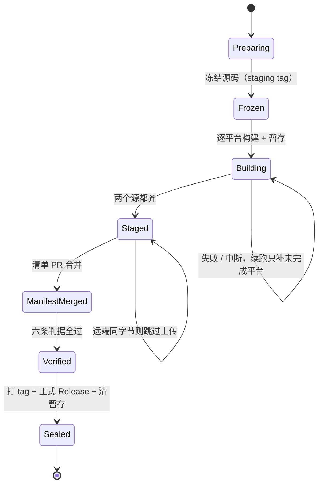

# 发布机械协议（发布内核 2.0）

> 软件版本发布的**执行规则**。流程合法性由内核判定，不靠人记「这次该干什么」。
> 改本文要作者点头。

## 0. 一句话

```text
冻结源码 → 多平台分批构建 → 资产集中暂存 → 统一上传两个源 → 清单合并 → 最后封版打 tag
```

**构建可以分批，发布必须统一。** 平台只负责产出安装包，发布权只在内核。

## 1. 状态机



状态**全部从远端现读派生**（`src-tauri/src/workbench/app/release/state.rs`）：

| 事实 | 来源 |
| --- | --- |
| 冻结源码 | `staging-<版本>` tag 指向的那一笔 |
| 每平台每源已到哪 | Gitee `attach_files`（名+大小+id）、GitHub release assets（名+大小+digest） |
| 清单已合并 | `origin/main:presets/delivery/release.json` 的 version 与 assets |
| 已封版 | 正式 tag `v<版本>` 存在 + 正式 Release 资产与清单逐份一致 |

本地 journal（`target/release-journal.jsonl`）**只记过程，不参与判断**。所以换机器、
换目录、上一趟被打断，都只是再跑一次同一条命令。

## 2. 两条远端通道，两个落点

| 用途 | 在哪 | 说明 |
| --- | --- | --- |
| 代码仓（PR / CI / 草稿镜像） | GitHub | `workflow_dispatch` 触发 Windows 构建；清单 PR 也开在这里 |
| 发布仓（正式下载） | Gitee | `release.json` 的主地址永远是 Gitee；GitHub 作 `sources.github` 镜像 |

**暂存面**：

```text
Gitee   Release @ staging-<版本>    （Gitee 没有草稿；这条 tag 不在 v* 命名空间，可删）
GitHub  Release  draft:true         （草稿不创建 tag，封版那一刻才发布）
```

封版时把同一批字节放进正式 Release：Gitee 只能重传（不能搬附件），GitHub 是把草稿
改成正式 tag 再发布。清理时删掉 Gitee 暂存 Release 与 staging tag。

## 2.5 三层判据（测试只测这六件责任）

| 层 | 证明什么 | 何时跑 | 依赖 |
| --- | --- | --- | --- |
| 纯函数判据 | 状态派生、清单合并、封版六条 | 每次 PR | 无 |
| 演练矩阵（`release::rehearsal`） | 冻结只建暂存面、补平台不丢资产、中断只补缺的源、身份读不懂就删重传、判据不足不封版、已封版重跑零写入、换机器从暂存面补字节、CI 失败停在上传前 | 每次 PR（`cargo test`） | 无网络 |
| 只读探针（`ship --probe`） | 适配器仍读得懂真接口（Gitee 200/null、GitHub 草稿、资产身份字段） | 发版前手动 | 两枚 token |

外部接口的事实与应对写在 [`RELEASE-CONTRACT.md`](RELEASE-CONTRACT.md)。**不给第三方 API 写全量契约测试**：
上传/下载/删除/列表的通用行为由真实发布那一次覆盖。

## 3. 命令

```bash
npm run ship -- --check                          # 只读：到哪一步、下一步做什么
npm run ship -- --probe                          # 只读：三条接口事实还成立吗（发版前）
npm run ship -- --what stable --dry-run          # 演练：零写入
npm run ship -- --what stable --confirm          # 真发（要人当次许可）
npm run ship -- --what stable --confirm --stop-after staging --platform windows   # 验收用：只做一半
```

它自己判断下一件事：冻结 → 构建（本机 macOS / CI Windows）→ 暂存 → 清单 PR（等 CI 绿、
squash 合并）→ 封版。

### 封版六条判据（任一不过就不许封版）

1. 所有计划支持的平台都齐了（`release::platforms::PLATFORMS` 里的每一行）；
2. Gitee 资产完整；
3. GitHub 资产完整；
4. 两边同一份字节的大小 / 摘要一致；
5. `main` 上的 `release.json` 含全部平台资产；
6. 版本号 / 源码 SHA / 资产身份一致（正式 tag 指向冻结源码）。

判据实装在 `release::state::derive`（纯函数，有单测）与 `release::seal::ensure_sealable`。

## 4. 不可逆保护

| 约束 | 怎么实现 |
| --- | --- |
| 正式 tag 只在封版时创建 | 之前所有资产落在暂存 tag / GitHub 草稿上 |
| tag 指向被构建的那一笔 | 封版用 `source_commit`（staging tag 指向它），不是 `main` 的 tip |
| 已封版的号不许重打 | `seal::create_formal_tag` 比对已存在 tag 的提交，不一致就停 |
| 上传前先读远端 | 同名同大小同摘要 ⇒ 跳过；同名不同字节 ⇒ 先删再传 |
| 不上传没有身份的包 | `ArtifactFact` 在读取文件那一刻定下 size + SHA-256，清单与上传只读它 |
| 清单基底永远取 `origin/main` | `manifest::published_info` 从 `git show origin/main:…` 读 |

## 5. 本地检查与 CI 同一入口

```text
scripts/check/
  web / rust / rust-windows / build / all
```

- `npm run lint` 里保留的发布自检只有静态那几格（`check-release-readiness.mjs --static`）与
  清单地址断代（`check-release-source.mjs`）。
- 内核单测：`cargo test -p mkp-support-ease --features workbench --lib release::`。

## 6. 故障场景

| # | 场景 | 期望 |
| --- | --- | --- |
| 1 | 构建中途失败 | 停在那个平台；已完成的平台与暂存资产保留 |
| 2 | 上传中断 | 重跑先读远端，同字节跳过，只补缺的那几份 |
| 3 | 换一台机器续跑 | `--check` 读出的状态与上一台一致，续跑不重传 |
| 4 | 清单 PR 的 CI 红 | 停在 ManifestMerged 之前；清单已在分支上，修完重跑 |
| 5 | 封版后重跑 | 判 `sealed`，不重复上传、不重复建 tag |
| 6 | 正式 tag 指向别的提交 | 停（不许重打/移动已封版的 tag） |
| 7 | 暂存与正式同名字节不同 | 判冲突停下（两份不同的包不能都叫这一版） |
| 8 | Gitee / GitHub 少一份 | 封版判据不过，列出缺哪几份 |
| 9 | GitHub 草稿被谁发布过 | 判冲突（暂存面必须先是草稿） |
| 10 | 版本号没合进 main | 预检直接拒（`origin/main` 的 `version.toml` 与目标不同） |
| 11 | 发布账户缺一条通道 | 预检直接拒（GitHub / Gitee 都要；不再等到镜像阶段才 401） |

## 7. 验收（0.0.16）

```text
1. npm run ship -- --what stable --confirm --stop-after staging --platform windows
2. 换一个终端 / 目录，npm run ship -- --check     # 应显示 Windows 已完成、macOS 未完成
3. npm run ship -- --what stable --confirm         # 只构建上传 macOS，接清单与封版
4. npm run ship -- --check                         # 应显示 sealed
5. 再跑一次 --confirm                              # 不重复上传、不重复建 tag
```
