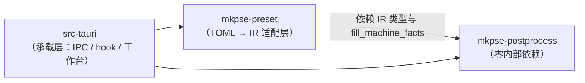

# 地图 6 · 核心边界与依赖地图

> 最后核对：2026-11-07（只读代码与 Cargo 依赖取证；未改动任何业务代码）
> 视角：**按核心与契约看**，不按"一条业务流水线"看。流程视角见 [`02-flows.md`](02-flows.md)。
> 判据：一条结论要么能落到 `文件:行`，要么标「未核实」。**共享文件格式 ≠ 共享业务核心；调用 ≠ 架构耦合**。

---

## 0. 一句话

SupportEase 实际是**四个业务核心 + 一层编排 + 一批契约**：

```
产品交互与编排层（前端页面 / IPC 命令壳 / 跨核心流程）
   │  只负责"什么时候调谁"，不含业务判据
   ├──> 配置与生成核心（机型 · 套餐 · 预设 · 参数 · 注册表 · 渲染）
   ├──> 文件与交付核心（资产 · 索引 · 交付集合 · 发布事务 · 序号）
   ├──> 后处理核心（G-code → IR → 结果）   ← 通过 IR 与外部隔离
   └──> 设备与运行环境（机型几何 · 切片器钩子 · 外部进程 · 运行时能力）
```

**IR 是后处理核心的入口契约，不是"共享模型"**：适配层（`crates/preset`）单向依赖后处理内核，把用户预设 TOML 翻成 IR；后处理内核零内部依赖（见 §2.1）。

---

## 1. 六个部分：入口 / 内部 / 数据所有权

| 部分 | 入口 | 内部模块 | 拥有的数据 | 对外接口 | **不应该依赖** |
|---|---|---|---|---|---|
| **配置与生成** | 工作台命令 `wb_apply_draft` / `wb_save` / `wb_generate`；CLI `presets generate` | `presetdata/`（catalog/bundles/assets/registry/resolve/patch）、`workbench/domain/`（derive/resolve）、`build.rs` 的 `render` | `presets/machines`、`presets/*.toml`、`bundles.toml`、`assets.toml`、`registry/` | 有效配方（`effective_recipe`）、可渲染行（`build_rows`）、产物字节（`render`） | G-code 语义、发布身份、HTTP/网络、界面状态 |
| **文件与交付** | `wb_delivery_*`、`wb_publish`、`wb_generate` 的事务段 | `fsx/`（原子写/回收站，**共享基础设施**）、`workbench/app/delivery.rs`、`publish_tx.rs`、`publish_book.rs`、`runtime/catalog.rs` | `presets/delivery/**`、`catalog.json`、`source.json`、`publish-serial.json`、备份/快照/回收站 | 交付集合与 diff、索引构建、发布事务、序号分配 | 参数含义、套餐业务规则、G-code 规则 |
| **后处理** | 切片器钩子 `main.rs:72` → `hook.rs:626`；CLI `mkpse-pp` | `crates/postprocess/src/{ir,gcode,pipeline,postproc}` | 输入 G-code、IR、输出 G-code、诊断/耗时 | `pipeline::process_with_ir*`、`Ir`（serde）、`diag::PostprocError` | 工作台、套餐、文件交付、前端类型、TOML 读取（见 §4.3） |
| **设备与运行环境** | `hook.rs` 的机型核对段；`machine_dims`；`main.rs` 的 Mode 分派 | `postproc/machine_dims.rs`、`presets/machines|forbidden_zones|calibration_models`、`runtime/{net,local,updater}` | 几何尺寸、禁区、校准档、外部进程与环境能力 | `machine_dims::tables()`、`fill_machine_facts`、程序启动模式 | 预设业务规则、套餐、界面 |
| **产品交互与编排** | `src/workbench/App.tsx`（8 页）、`src/app/**`（客户端 UI）、`src-tauri/src/ipc/**` | 页面组件、`api.ts`、命令壳 `wb_*`、`with_ctx` 会话 | 界面状态、草稿、选中项、tick（**都不落盘**） | 用户操作 → 命令 → DTO | 业务判据（不许在前端重算）、文件字节规则 |
| **契约（不属于任何核心）** | — | `Ir`、`catalog` schema、`source` 寻址、IPC DTO、错误码 | 结构定义与版本号 | 各核心按契约通信 | 任何一方的内部实现 |

**关键分界（容易搞错的两处）**

- `fsx::atomic` 是**共享基础设施**，不是"文件与交付核心"的专有服务：配置核心自己也直接 `atomic_write`（`presetdata/bundles.rs:191`、`assets.rs:661`、`catalog.rs:1482`）。"写文件"不是某个核心的特权，"决定交付什么"才是。
- `workbench/app/*.rs` 里同时住着**命令壳（产品层）**与**锁无关内核（各核心）**：`wb_finalize_preview` 是壳，`finalize_preview_with` 属交付核心。看边界时按函数分，不按文件分。

---

## 2. 依赖方向（实测）

### 2.1 crate 层：后处理是叶子，适配层单向依赖它



证据：

| 事实 | 位置 |
|---|---|
| `mkpse-postprocess` 依赖表里**没有任何内部 crate**（只有 tracing / serde / toml / sha2 / flate2 / clap / ctrlc） | `crates/postprocess/Cargo.toml` 的 `[dependencies]` |
| `mkpse-preset` 唯一的内部依赖是 `mkpse-postprocess`（方向写死） | `crates/preset/Cargo.toml` 注释 + `[dependencies]` |
| 后处理源码里 `presetdata` / `workbench` / `tauri` / `bundle` **0 命中**（只有注释提到 `src-tauri`） | `grep -rn "presetdata\|workbench\|bundle\|tauri" crates/postprocess/src` |
| `hook.rs` 对 `crate::workbench` **0 引用** | `grep -rn "crate::workbench" src-tauri/src/hook.rs` |
| 后处理自带两条机械边界判据（gcode 模块保持纯、全仓禁 FMA） | `crates/postprocess/tests/boundaries.rs:114`、`:193` |

### 2.2 承载层内部：工作台大量复用"客户端运行时"的契约

`src-tauri/src/workbench` 对 `crate::runtime::*` 的引用次数（实测）：

| 符号 | 次数 | 性质 | 判断 |
|---|---|---|---|
| `runtime::catalog` | 62 | 索引结构与构建 | **共享契约**（交付核心的索引 = 客户端读的索引） |
| `runtime::source` | 26 | 寻址/发布清单 | 共享契约 |
| `runtime::release_info` | 12 | 软件版本链 | 另一条链，合理 |
| `runtime::structure` | 7 | 目录结构判据 | 共享契约 |
| `runtime::resolver` | 7 | URL 解析（发布闸 ⑬⑯） | **刻意共享**：闸必须按客户端规则核对（`audit.rs:1013/1099/1166/1179/1203`） |
| `runtime::net` | 4 | 系统代理 / 端口探测 | 运行时能力，非业务 |

结论：**工作台依赖的是客户端的"格式与寻址契约"，不是客户端的业务实现**（没有引用 `runtime::local::apply_*` 这类下载/落盘逻辑）。

### 2.3 反向依赖检查（有没有核心反过来依赖上层）

| 检查 | 结果 | 证据 |
|---|---|---|
| `presetdata` 生产代码是否依赖 `workbench` | **否**（唯一命中在 `#[cfg(test)] mod tests` 的测试辅助 `now()`） | `presetdata/mod.rs:1273-1275` 在 `#[cfg(feature="workbench")]` 测试函数内 |
| `crates/*` 是否依赖 `src-tauri` | **否**（crate 独立，`src-tauri` 在其上层） | 两个 `Cargo.toml` 无 `src-tauri` 依赖 |
| `hook.rs` 是否依赖工作台事务 | **否** | 上表 |
| 前端是否直接持业务判据 | **否**（页面只做展示映射：`BuildPage` 的 `gotoOf`、`deliveryStatus.ts` 的 `stateText`） | `src/workbench/views/BuildPage.tsx`、`views/deliveryStatus.ts` |

---

## 3. 七个必答问题

### 3.1 每个核心的入口、内部模块、数据所有权？

见 §1 表。补充两点：

- 配置核心的**唯一输出**是"有效配方 + 可渲染行 + 产物字节"（`resolve.rs:303`、`derive.rs` 的 `build_rows`、`build.rs:290` 的 `render`）。
- 交付核心的**唯一输出**是"交付目录里的字节 + 索引 + 发布身份"，它不解释参数含义（`delivery.rs` 不知道某个参数是温度还是回抽）。

### 3.2 哪些核心可以独立运行、测试与重构？

| 核心 | 独立运行 | 独立测试（现成证据） |
|---|---|---|
| 后处理 | ✅ CLI `mkpse-pp run/init/dump-ir/check`（`crates/postprocess/src/main.rs:84-120`） | ✅ `tests/boundaries.rs` 两条判据；`crates/preset` 的 `load_ir` 整链判据 |
| 配置与生成 | ⚠️ 需工作台会话（`Ctx`）才能跑 `render` | ✅ `derive` / `resolve` / `bundles` 单测（`domain/derive.rs`、`presetdata/*`） |
| 文件与交付 | ⚠️ 依赖 `presets/` 真仓库 | ✅ `delivery.rs` 的夹具事务测试、`publish_book` 幂等测试 |
| 设备与运行 | ✅ `machine_dims` 直接读 `presets/` | ✅ `machine_dims` 单测 |
| 产品层 | ✅ 前端可 `?mock=1` 起 | ⚠️ 无组件测试（只靠浏览器探针） |

### 3.3 核心之间通过什么接口通信？

| 从 → 到 | 接口 | 形态 |
|---|---|---|
| 配置 → 交付 | 产物字节 + `build_rows`（哪些版该有产物） | 函数调用（同进程） |
| 配置 → 后处理 | **产物 TOML 文件**（稳定格式） | 文件 + argv 路径（`ipc/mod.rs:626-654`） |
| 后处理 → 配置 | **无**（后处理不改预设） | — |
| 交付 → 客户端 | `catalog.json` / `source.json` / 产物字节 | 文件 + HTTP |
| 设备 → 后处理 | `machine_dims::tables()`（读 `presets/`） | 函数调用 + 数据文件 |
| 产品层 → 各核心 | `invoke('wb_*')` → 命令壳 → `*_with` | IPC |

### 3.4 哪些地方存在跨核心直接读写、反向依赖或重复实现？

见 §5（违规/疑似清单，逐条带证据与判定）。

### 3.5 IR 是否真正隔离了后处理？

**基本是，但有三处需要盯**（详见 §4）。

### 3.6 文件管理核心是否理解了不该理解的业务语义？

**没有理解 G-code**：`workbench/app/delivery.rs` 里 `bbs` / `gcode` 的命中全在注释与测试（`delivery.rs:40-90` 是沿革注释、`:2424+` 是测试夹具），生产逻辑只处理"资产类型 → 落点"（`runtime/catalog.rs:256-305`）。

但有一处**半个业务语义**：交付核心知道 `slicerProfile` / `mkpPreset` 这些**资产类型枚举**。判定：可接受 —— 它需要知道"这类资产怎么落盘"，不需要知道"BBS 里写了什么参数"。

### 3.7 套餐、预设、参数分别属于哪个领域？

| 对象 | 归属 | 理由 |
|---|---|---|
| **套餐** | 配置与生成核心（**资源组织规则**） | 正文是 `assetRefs`（`presets/bundles.toml`），由配置核心解析（`mod.rs:681/706`），不含参数、不参与渲染（`resolve.rs:303` 0 命中） |
| **预设（产物 TOML）** | 配置与生成核心的**输出** | `render`（`build.rs:290`）按注册表 + 有效配方产出 |
| **参数** | 配置与生成核心 | 定义在 `registry/`，值在 `machineVariants`，合并规则在 `resolve.rs` |
| **资产** | 文件与交付核心（生命周期），类型语义来自配置核心 | `dest_of_asset`（`runtime/catalog.rs:300`）决定落点；`assets.toml` 由配置核心维护 |
| **BBS 预设（切片器工艺档）** | 文件与交付核心（落盘/下载/复制）+ 产品层（BBS 页展示） | 落点 `assets/bbs/…`（`catalog.rs:258`）；读取在 `ipc/catalog.rs:239` 与 `src/app/bbs/**`；生效靠 `copy_to_slicer`（`ipc/presets.rs:1062`）写切片器目录。**后处理 0 依赖**（`crates/postprocess` 仅注释、`hook.rs` 0 命中） |
| **IR** | 契约，物理上住后处理 crate | `crates/postprocess/src/ir/types.rs:358`，字段只有 toolhead/wiping/tower/disk/ironing/glue…（无套餐/预设/交付概念） |

**为什么套餐不能归文件核心**：它对交付的影响是"这份资产是否可达"（`delivery.rs:378-382`），这是**配置侧给出的输入**；交付核心若自己解释套餐，就要理解"成套配发"的业务规则（至少一条 BBS）—— 那是配置语义。

---

## 4. IR 边界专项

### 4.1 输入边界：后处理究竟接收什么

| 输入 | 形态 | 证据 |
|---|---|---|
| G-code 文件 | 路径（原地覆盖，另存归档） | `hook.rs:626/661-694`、`pipeline/mod.rs:480-492` |
| 配置 | **IR**（由适配层从预设 TOML 翻译，或 CLI `-c` 直接给 IR TOML） | `crates/preset/src/lib.rs:176-179`、`crates/postprocess/src/config.rs:1-33` |
| 运行上下文 | 机型几何（`presets/`）、设置页偏好（`Ir.prefs`） | `machine_dims.rs:175-237`、`postproc_prefs.rs:50` |

### 4.2 转换边界：谁负责 TOML → IR

**只有一处**：`crates/preset`（`lib.rs:176` `load_ir`），且方向是 `preset → postprocess`（`Cargo.toml`）。后处理**不读 TOML** —— 这条在 `boundaries.rs:20-38` 里被列为"当前成立但**没有守卫**"的三条之一（扫描面：`src/postproc/` 里 `toml::` 0 命中）。

后处理源码里唯一提到 `preset` 的地方是一条设计声明：`crates/postprocess/src/ir/defaults.rs:5` 注释写"本项目**不要预设文件**，所以那段连同整个 `preset` crate 不搬"——这是"IR 隔离"意图的直接书面证据，不是依赖。

### 4.3 内部边界：IR 是否自足

`Ir`（`crates/postprocess/src/ir/types.rs:358`）字段是后处理自己的词表：`schemaVersion / toolhead / wiping / tower / disk / ironing / glue / …`。**没有** `bundle` / `preset` / `machine`（机型以几何事实注入，见 `fill_machine_facts`）。

### 4.4 输出边界：后处理输出什么

- 写回 G-code（原地 `.part` + rename）。
- 结构化回执：进度事件（`hook_ipc`）、`;MKP_INFO` / `;MKP_STATS` 标记（`postproc/marks.rs`）、耗时字段。
- **调用方不需要知道内部阶段**：承载层只消费事件与标记，不读 pipeline 中间结果。

### 4.5 结论与缺口

| 问题 | 结论 |
|---|---|
| 后处理有没有反向依赖工作台/套餐/文件管理？ | **没有**（§2.1、§2.3） |
| 后处理是否必须知道套餐是什么？ | **不需要**（0 命中） |
| 有没有"看起来耦合"其实是契约？ | 有：`hook.rs:1344/1362` 用 `presetdata::params::read_param_values` / `missing_param_keys`，这是**承载层**为了在归档里记录"当时那份预设写了什么"，不是后处理核心依赖配置核心 |
| 缺口 | 三条不变量只靠人守（速度换算只在 `ir`、`postproc` 不读 TOML、subscriber 只在可执行边界），`boundaries.rs:20-38` 自己写明了 |

---

## 5. 跨核心违规 / 疑似清单

| # | 现象 | 证据 | 判定 |
|---|---|---|---|
| C1 | 承载层为了报告读配置核心的参数值 | `hook.rs:1344`、`:1362` | **可接受**（只读、只用于归档文案；不属于后处理核心） |
| C2 | 工作台复用客户端 `resolver` / `catalog` | `audit.rs:1013/1099/1166/1179/1203`、`delivery.rs:136` | **刻意契约共享**：闸按客户端规则核账 |
| C3 | 交付核心知道资产类型枚举（`mkpPreset` / `slicerProfile`） | `runtime/catalog.rs:256-305`、`delivery.rs:790-807` | **可接受**（知道落点，不知道内容语义） |
| C4 | 配置核心自己写盘（不经交付核心） | `presetdata/bundles.rs:191`、`assets.rs:661`、`catalog.rs:1482` | **可接受**：`fsx` 是共享基础设施；但"谁能写 `presets/`"要有一条书面规则（未核实是否已有） |
| C5 | 交付集合有 5 套算法、只有 1 处认 `enabled` | 见 `05-problems.md` A1 | **真问题**（重复实现，不是边界问题） |
| C6 | `manifest` 被当成持久凭据 | 见 `05-problems.md` A2 | **真问题**（同一事实两处状态） |
| C7 | 前端 `deliveryStatus.ts` 做状态文案映射 | `views/deliveryStatus.ts` | **可接受**（展示映射，不产出判据） |
| C8 | `workbench/app/*.rs` 命令壳与领域内核同文件 | `build.rs` 的 `wb_*` 与 `*_with` | **结构性负债**：边界按函数分，不按文件分；重构时先拆文件更省事 |
| C9 | BBS 预设的消费横跨文件核心与产品层 | 落点 `catalog.rs:258`、读取 `ipc/catalog.rs:239` / `src/app/bbs/**`、写入切片器 `ipc/presets.rs:1062` | **不是越界**：文件核心管落盘与复制，产品层管展示；后处理 0 依赖 |
| C10 | `Patch::SetBundle` 草稿通道无前端入口 | `derive.rs:298-301`（overlay 优先）＋ `api.ts:806`（只有类型） | **潜在死路径**：接上前必须同时定 `require_clean` 语义（见 `05-problems.md` A10） |

---

## 6. 每核心的可独立验证清单

| 核心 | 今天能跑的 | 缺的 |
|---|---|---|
| 后处理 | `cargo test -p mkpse-postprocess`（含两条边界判据）；`mkpse-pp dump-ir` | 三条无守卫的不变量（见 §4.5） |
| 适配层 | `cargo test -p mkpse-preset`（`load_ir` 整链、写回往返） | — |
| 配置与生成 | `cargo test … -- workbench::domain::derive workbench::app::build` | 渲染与注册表的"键序稳定"判据（现有测试覆盖部分） |
| 文件与交付 | `cargo test … -- workbench::app::delivery workbench::app::publish_book` | 交付集合收敛后的端到端判据（等 Delivery Lab） |
| 产品层 | `node .scratch/kb-walk/walk.mjs`（只读走查） | 组件级测试 |

---

## 7. 验收问题（这张图必须能回答）

1. 后处理能不能只靠 `Ir` + G-code 跑起来，不引入工作台/套餐？（§4）
2. 改「套餐」的业务规则（比如允许没有 BBS），需要动哪些核心？为什么不该动后处理？（§1/§3.7）
3. 交付核心要新增一种资产类型，需要改配置核心吗？（看 `dest_of_asset` 与资产类型枚举归属）
4. 工作台为什么能用客户端 `resolver`，而不会被客户端业务绑住？（§2.2）
5. 如果要把"交付集合"收成一处，应该落在哪个核心、谁是它的唯一调用方？（§5 C5）

---

## 8. 未核实

1. `presets/` 的**写权限规则**（谁能写、经不经 `fsx`）是否有书面约定 —— 只见各模块自行 `atomic_write`。
2 `machine_dims::install()` 在发布物里的接线（`HANDOFF.md:259` 记欠账）。
3. `crates/postprocess/src/postproc/**` 内部是否真的没有回读 `presets/`（只按 `machine_dims` 一处确认；`pass1/pass2/tower` 未逐段读）。
4. 前端是否存在**隐藏的判据**（例如某处自己算"能不能修"）—— 本轮只抽查了 `BuildPage` / `deliveryStatus`，未全量。
